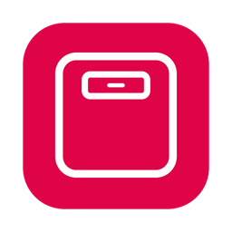
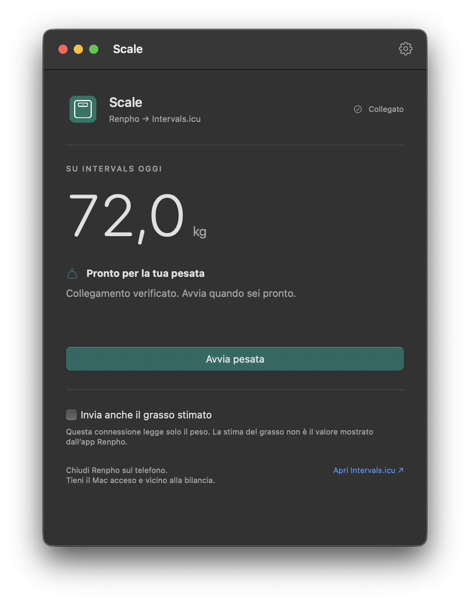
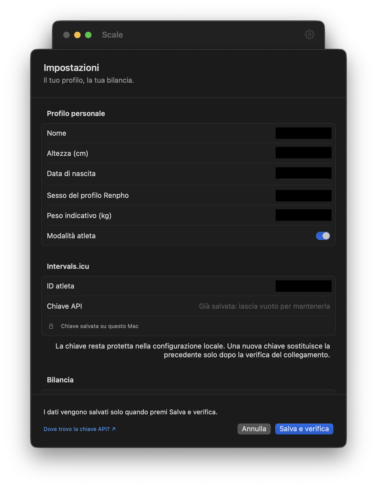

# Scale per Mac — da Renpho a Intervals.icu



Scale è un'app per macOS che usa [ble-scale-sync](https://github.com/KristianP26/ble-scale-sync) per leggere il peso da una bilancia Renpho ES-CS20M e sincronizzarlo con Intervals.icu. Dall'interfaccia puoi avviare una pesata: Scale invia il risultato e verifica il salvataggio rileggendo il servizio.

L'integrazione è stata sviluppata per la Renpho ES-CS20M e non è stata verificata con le altre bilance supportate dal motore. Scale è un progetto indipendente, non affiliato né approvato da Renpho o Intervals.icu.

[Installa da sorgente](#installazione-da-sorgente) · [Come funziona](#come-funziona) · [Privacy e dati](#privacy-e-dati) · [Sviluppo](CONTRIBUTING.md)

## Schermate

| Pesata | Impostazioni |
| --- | --- |
|  |  |

Le schermate mostrano una versione precedente dell'icona; l'icona attuale è quella mostrata sopra.

## Come funziona

1. Configura il profilo e il collegamento a Intervals.icu nelle impostazioni.
2. Premi **Avvia pesata** e sali sulla bilancia, tenendo il Mac acceso e vicino al dispositivo. Chiudi l'app Renpho sul telefono.
3. Scale acquisisce il peso tramite il motore BLE, lo invia a Intervals.icu e rilegge il servizio per verificare il risultato.

Per impostazione iniziale viene inviato solo il peso. Puoi attivare l'invio del grasso stimato: è una stima e non il valore mostrato dall'app Renpho. Più pesate nello stesso giorno aggiornano il record giornaliero. L'app non importa lo storico Renpho e non è configurata per l'avvio automatico.

## Requisiti

- Mac Apple Silicon con macOS 14 o successivo, Bluetooth e connessione Internet.
- Apple Command Line Tools, Python 3, npm e Git. La compilazione del motore può richiedere gli strumenti nativi previsti da ble-scale-sync.
- Una bilancia Renpho ES-CS20M, un account Intervals.icu e una chiave API personale.

## Installazione da sorgente

È necessaria la compilazione locale: il repository non include un'app già pronta. Da Terminale, clona il progetto con il submodule del motore:

```sh
git clone --recurse-submodules https://github.com/chrimatte/Scale.git
cd Scale
```

Se hai già una copia senza submodule, esegui `git submodule update --init` dalla cartella del progetto. Poi, dalla radice:

```sh
npm ci --prefix work/runtime
export PATH="$PWD/work/runtime/node_modules/.bin:$PATH"
npm ci --prefix ble-scale-sync
npm run build --prefix ble-scale-sync
cp -n Scale-sorgenti/config.yaml.example ble-scale-sync/config.yaml
chmod 600 ble-scale-sync/config.yaml
./Scale-sorgenti/build.sh
./Scale-sorgenti/install.sh
```

Il comando `cp -n` preserva un profilo già presente. Il modello iniziale contiene dati fittizi: apri `~/Applications/Scale.app`, vai in **Impostazioni**, inserisci profilo, ID atleta e chiave API di Intervals.icu, quindi scegli **Salva e verifica**. La verifica richiede una connessione al servizio.

La chiave viene salvata in `ble-scale-sync/.env` e il profilo in `ble-scale-sync/config.yaml`; entrambi sono locali ed esclusi da Git. La chiave viene inviata a Intervals.icu tramite HTTPS per autenticare le richieste. Non condividere quei file.

L'app installata dipende dalla cartella del progetto e dal motore compilato: non spostarli o eliminarli. Se sposti la cartella completa, ricompila e reinstalla. Gli script mantengono copie precedenti in `work/backups`. Per i dettagli e i controlli consulta [CONTRIBUTING.md](CONTRIBUTING.md) e [Scale-sorgenti/README.md](Scale-sorgenti/README.md).

## Avvio alternativo e sviluppo

I due file `.command` nella cartella principale offrono un'interfaccia alternativa al motore: il primo verifica il collegamento a Intervals.icu, il secondo avvia la sincronizzazione continua. Richiedono un profilo configurato. Non usare contemporaneamente l'app e la sincronizzazione continua: accedono alla stessa bilancia.

Il repository contiene un riferimento Git al motore, scaricato separatamente dal progetto originale tramite submodule. Per contribuire, eseguire i test o aggiornare il motore consulta [CONTRIBUTING.md](CONTRIBUTING.md); per dettagli su compilazione e installazione consulta la [guida tecnica](Scale-sorgenti/README.md).

## Privacy e dati

Scale memorizza il profilo e la chiave API nel progetto sul Mac. Le pesate e i dati necessari al funzionamento sono conservati localmente e inviati a Intervals.icu; Scale legge anche i dati del servizio necessari alla verifica. Il progetto non prevede un server proprio di raccolta dati né funzioni di telemetria. Intervals.icu tratta i dati ricevuti secondo le proprie condizioni e la propria informativa privacy.

La chiave API dà accesso ai dati dell'account: ogni utente è responsabile della sua custodia e deve proteggere il proprio Mac e i backup, senza pubblicare `.env`, il profilo, le pesate o i log che possono contenerli. L'autore non assume responsabilità per la custodia o la divulgazione della chiave da parte dell'utente, nei limiti consentiti dalla legge. Se sospetti che la chiave sia stata esposta, rigenerala su Intervals.icu. L'uso dell'API è soggetto ai [termini di Intervals.icu](https://forum.intervals.icu/t/intervals-icu-api-terms-and-conditions/114087).

## Destinazione d'uso e responsabilità

Scale è uno strumento amatoriale destinato al monitoraggio personale e al benessere. Non è un dispositivo medico e non è destinato a diagnosi, prevenzione o trattamento di condizioni mediche. Le informazioni e le stime fornite non sostituiscono il parere di un professionista sanitario.

Il software è fornito senza garanzie, nei limiti consentiti dalla legge. L'autore non assume responsabilità per danni derivanti dall'uso, da errori di misurazione o sincronizzazione, né dalla disponibilità di servizi o dispositivi di terze parti, nei limiti consentiti dalla legge. Controlla i valori registrati su Intervals.icu e conserva backup dei dati importanti.

## Realizzazione

Scale è stato progettato e sviluppato con l'assistenza di [OpenAI Codex](https://openai.com/codex/). Il motore [ble-scale-sync](https://github.com/KristianP26/ble-scale-sync) è opera del progetto originale e dei suoi contributori. L'icona è stata generata con l'ausilio di intelligenza artificiale.

## Licenza

Il codice e le risorse originali di Scale sono distribuiti secondo la [GNU General Public License versione 3](LICENSE) (GPL-3.0-only). Il motore [ble-scale-sync](https://github.com/KristianP26/ble-scale-sync), sviluppato separatamente, mantiene la propria licenza GPL-3.0 e i relativi avvisi, disponibili nel suo repository.
