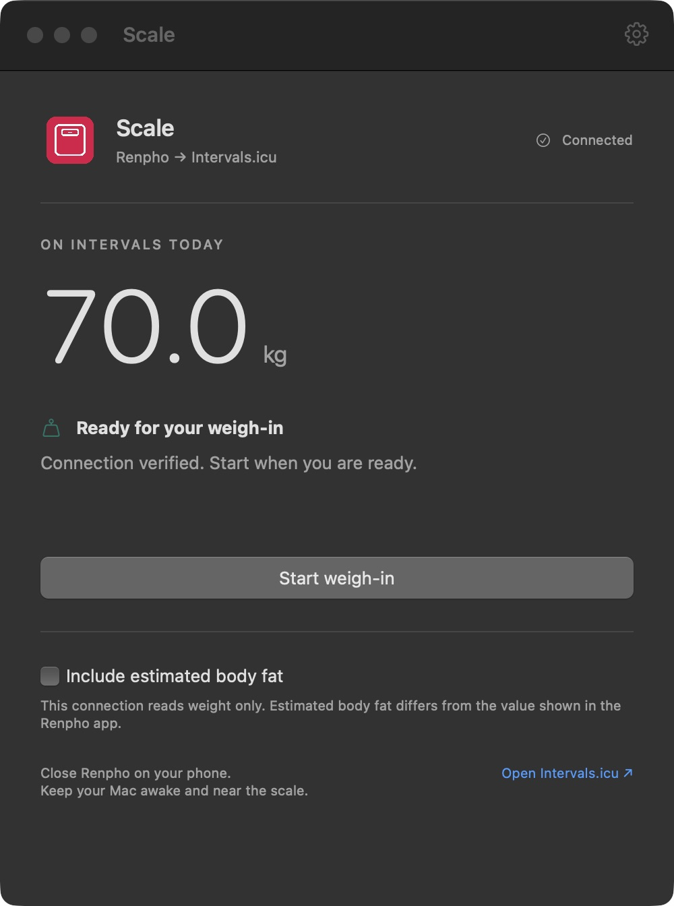
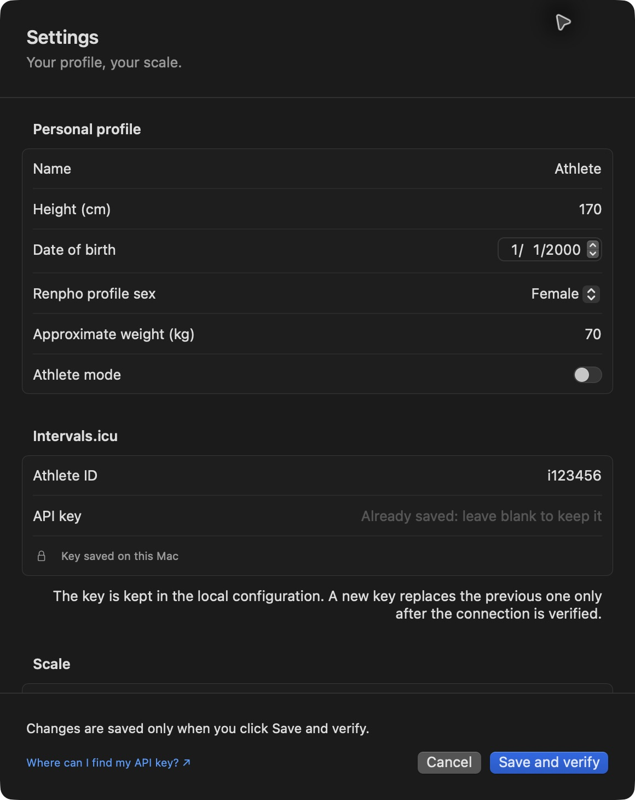

# Scale for Mac — from Renpho to Intervals.icu


Scale is a macOS app that uses [ble-scale-sync](https://github.com/KristianP26/ble-scale-sync) to read weight from a Renpho ES-CS20M scale and sync it with Intervals.icu. Start a weigh-in from the app: Scale uploads the result and verifies it by reading the saved data back from the service.

The integration was developed for the Renpho ES-CS20M and has not been verified with the other scales supported by the engine. Scale is an independent project, unaffiliated with and not endorsed by Renpho or Intervals.icu.

[Install from source](#installation-from-source) · [How it works](#how-it-works) · [Privacy and data](#privacy-and-data) · [Development](CONTRIBUTING.md)

## Screenshots

| Weigh-in | Settings |
| --- | --- |
|  |  |

Screenshots use fictional profile and measurement data.

## How it works

1. Set up your profile and Intervals.icu connection in Settings.
2. Click **Start weigh-in** and step on the scale, keeping your Mac awake and near the device. Close the Renpho app on your phone.
3. Scale reads your weight through the BLE engine, uploads it to Intervals.icu and reads the saved data back to verify the result.

Only weight is uploaded by default. You can enable estimated body fat: this is an estimate and differs from the value shown in the Renpho app. Multiple weigh-ins on the same day update the daily record. The app does not import Renpho history and is not configured to start automatically.

## Requirements

- Apple Silicon Mac with macOS 14 or later, Bluetooth and an Internet connection.
- Apple Command Line Tools, Python 3, npm and Git. Building the engine may require the native tools specified by ble-scale-sync.
- A Renpho ES-CS20M scale, an Intervals.icu account and a personal API key.

## Installation from source

A local build is required: the repository does not include a ready-to-use app. In Terminal, clone the project with the engine submodule:

```sh
git clone --recurse-submodules https://github.com/chrimatte/Scale.git
cd Scale
```

If you already have a copy without the submodule, run `git submodule update --init` from the project folder. Then, from the repository root:

```sh
npm ci --prefix work/runtime
export PATH="$PWD/work/runtime/node_modules/.bin:$PATH"
npm ci --prefix ble-scale-sync
npm run build --prefix ble-scale-sync
cp -n Scale-sources/config.yaml.example ble-scale-sync/config.yaml
chmod 600 ble-scale-sync/config.yaml
./Scale-sources/build.sh
./Scale-sources/install.sh
```

The `cp -n` command preserves an existing profile. The starter template contains fictional data: open `~/Applications/Scale.app`, go to **Settings**, enter your profile, Intervals.icu athlete ID and API key, then click **Save and verify**. Verification requires a connection to the service.

The key is saved in `ble-scale-sync/.env` and the profile in `ble-scale-sync/config.yaml`; both are local and excluded from Git. The key is sent to Intervals.icu over HTTPS to authenticate requests. Do not share these files.

The installed app depends on the project folder and the compiled engine: do not move or delete them. If you move the complete folder, rebuild and reinstall. The scripts keep previous copies in `work/backups`. See [CONTRIBUTING.md](CONTRIBUTING.md) and [Scale-sources/README.md](Scale-sources/README.md) for details and checks.

## Alternative launchers and development

The two `.command` files in the root folder provide an alternative interface to the engine: `1 - Connect Intervals.command` verifies the Intervals.icu connection, and `2 - Start sync.command` starts continuous synchronization. They require a configured profile. Do not run the app and continuous synchronization at the same time: they access the same scale.

The repository contains a Git reference to the engine, downloaded separately from the original project as a submodule. See [CONTRIBUTING.md](CONTRIBUTING.md) to contribute, run tests or update the engine; see the [technical guide](Scale-sources/README.md) for build and installation details.

## Privacy and data

Scale stores your profile and API key in the project folder on your Mac. Weigh-ins and data needed for operation are stored locally and sent to Intervals.icu; Scale also reads service data needed for verification. The project has no data collection server of its own and no telemetry features. Intervals.icu processes the data it receives according to its own terms and privacy policy.

The API key grants access to account data: each user is responsible for keeping it safe and protecting their Mac and backups, without publishing `.env`, their profile, weigh-ins or logs that may contain this information. To the extent permitted by law, the author accepts no liability for the user's storage or disclosure of the key. If you suspect the key has been exposed, regenerate it on Intervals.icu. API use is subject to the [Intervals.icu terms](https://forum.intervals.icu/t/intervals-icu-api-terms-and-conditions/114087).

## Intended use and liability

Scale is a hobby project intended for personal tracking and wellness. It is not a medical device and is not intended to diagnose, prevent or treat medical conditions. The information and estimates it provides do not replace advice from a healthcare professional.

The software is provided without warranties, to the extent permitted by law. To the extent permitted by law, the author accepts no liability for damages arising from use, measurement or synchronization errors, or the availability of third-party services or devices. Check the values recorded on Intervals.icu and keep backups of important data.

## Credits

Scale was designed and developed with assistance from [OpenAI Codex](https://openai.com/codex/). The [ble-scale-sync](https://github.com/KristianP26/ble-scale-sync) engine is the work of the original project and its contributors. The icon was generated with the help of artificial intelligence.

## License

Original Scale code and assets are distributed under the [GNU General Public License version 3](LICENSE) (GPL-3.0-only). The separately developed [ble-scale-sync](https://github.com/KristianP26/ble-scale-sync) engine retains its own GPL-3.0 license and notices, available in its repository.
